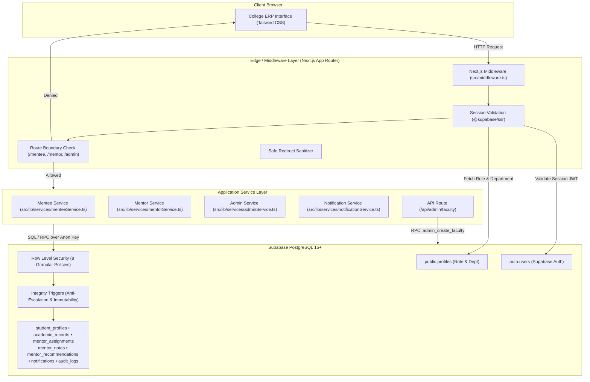
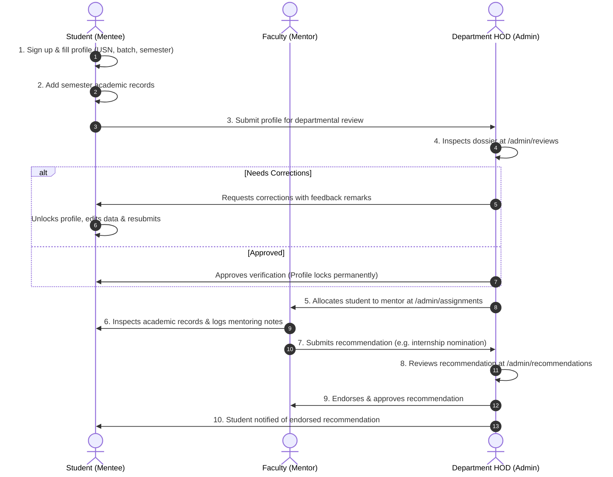
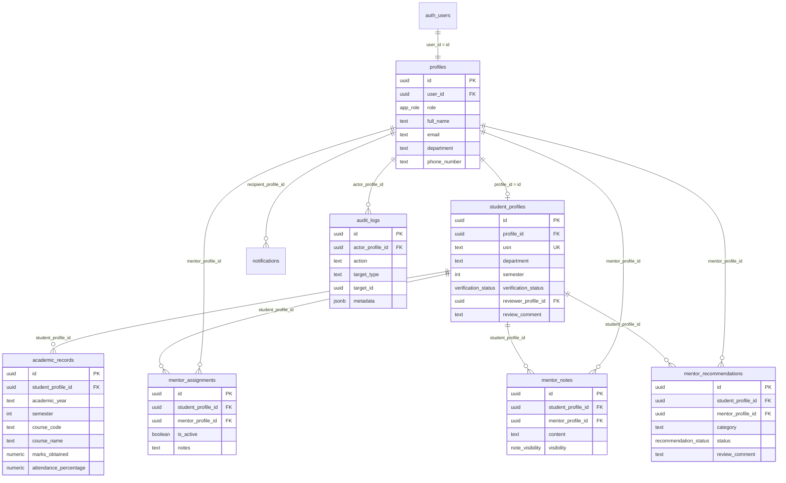

# College Mentor–Mentee Management System (MMS)

A production-minded, institutional college ERP platform designed for higher education institutions to manage, monitor, and streamline mentorship workflows between students, faculty mentors, and Department Heads (HODs).

Built with **Next.js 14 (App Router)**, **TypeScript**, **Tailwind CSS**, and **Supabase (PostgreSQL with Row Level Security & Supabase Auth)**.

---

## Table of Contents

- [1. Project Title and Introduction](#1-project-title-and-introduction)
- [2. Key Features](#2-key-features)
- [3. Technology Stack](#3-technology-stack)
- [4. Application Architecture](#4-application-architecture)
- [5. Project Folder Structure](#5-project-folder-structure)
- [6. Prerequisites](#6-prerequisites)
- [7. Getting the Source Code](#7-getting-the-source-code)
- [8. Install Dependencies](#8-install-dependencies)
- [9. Create and Configure a Supabase Project](#9-create-and-configure-a-supabase-project)
- [10. Environment Variables](#10-environment-variables)
- [11. Database Setup and Import](#11-database-setup-and-import)
- [12. Row Level Security and Permissions](#12-row-level-security-and-permissions)
- [13. Authentication and Account Setup](#13-authentication-and-account-setup)
- [14. Run the Project Locally](#14-run-the-project-locally)
- [15. Available Commands](#15-available-commands)
- [16. Application Workflow](#16-application-workflow)
- [17. Database Relationships and Data Flow](#17-database-relationships-and-data-flow)
- [18. Demo Accounts and Testing](#18-demo-accounts-and-testing)
- [19. Troubleshooting](#19-troubleshooting)
- [20. Deployment Guide](#20-deployment-guide)
- [21. Security Best Practices](#21-security-best-practices)
- [22. Contributing and Development](#22-contributing-and-development)
- [23. Future Improvements](#23-future-improvements)
- [24. License](#24-license)

---

## 1. Project Title and Introduction

### Problem Statement
In higher education colleges and universities, student academic mentorship is often tracked using fragmented spreadsheets, manual paper forms, or disconnected email chains. This creates significant operational hurdles:
- **Faculty Mentors** struggle to track semester-by-semester academic progression, attendance flags, and student follow-ups.
- **Students (Mentees)** lack transparency into their verification status, official review remarks, and mentor guidance.
- **Department Heads (HODs)** cannot easily review student demographic and academic submissions, balance mentor allocations, endorse merit or remedial recommendations, or inspect an immutable audit history of institutional decisions.

### Solution Overview
The **College Mentor–Mentee Management System (MMS)** provides a unified, role-governed college ERP portal:
- **Students** manage their academic dossiers, track submissions, and communicate with assigned mentors.
- **Faculty Mentors** monitor their assigned cohort, record private and shared mentoring session logs, and submit recommendations for departmental endorsement.
- **HOD Administrators** oversee departmental student and faculty directories, verify student records, allocate mentors, and review recommendations through a dedicated review queue.

### Project Status & Known Limitations
- **Current Status**: Production-ready core implementation with full database schema, RLS policies, Next.js App Router edge routing, and comprehensive role portals.
- **Known Limitations**:
  - In-app notifications are delivered via database triggers and real-time client polling; third-party email/SMS gateways (e.g., Resend, AWS SES) are not yet integrated.
  - Student enrollment is performed via individual registration or administrative directories; bulk CSV ingestion is planned for a subsequent release.

---

## 2. Key Features

### Mentee / Student Portal (`/mentee/*`)
- **Dashboard (`/mentee/dashboard`)**: Welcome summary, semester/department indicators, profile completion status, assigned mentor details, and recent notifications.
- **Profile Management (`/mentee/profile`)**: Manage personal details, phone number, blood group, parent contact, and academic batch. Once assigned, institutional USN is locked from unapproved alteration.
- **Academic Records (`/mentee/academics`)**: Enter, view, and calculate semester course grades, credits, attendance percentages, and SGPA calculations.
- **My Mentor (`/mentee/mentor`)**: View assigned faculty mentor contact details and read guidance notes shared specifically with the student.
- **Verification Desk (`/mentee/verification`)**: Submit profile dossiers to the HOD for official departmental verification, track status (`draft`, `submitted`, `approved`, `rejected`, `correction_requested`), and resubmit after addressing reviewer remarks.
- **Notifications (`/mentee/notifications`)**: In-app notification center with read/unread filtering, unread badge counters, and deep links.

### Mentor / Faculty Portal (`/mentor/*`)
- **Dashboard (`/mentor/dashboard`)**: Metric summaries of assigned students, pending recommendations, and students requiring academic follow-up.
- **Assigned Students Directory (`/mentor/students`)**: Searchable and filterable table of assigned mentees. Isolated via Row Level Security (mentors cannot query unassigned students).
- **Student Dossier (`/mentor/students/[id]`)**: Multi-tab view including personal details, academic semester records, mentoring logs, recommendation history, and audit milestones.
- **Mentoring Notes Desk (`/mentor/notes`)**: Create and manage dated session notes with explicit visibility controls (`shared_with_mentee`, `private_mentor_only`, `department_only`).
- **Recommendations (`/mentor/recommendations`)**: Submit structured recommendations (internship nominations, remedial academic support, scholarships, disciplinary, or merit awards) to the HOD.
- **Notifications (`/mentor/notifications`)**: Real-time alerts for student submissions, allocations, and HOD endorsement decisions.

### Administrator / HOD Portal (`/admin/*`)
- **Dashboard (`/admin/dashboard`)**: Department-wide metrics (total students, awaiting review, approved profiles, corrections requested, active faculty).
- **Student Directory (`/admin/students`)**: Department-scoped student list with search, semester filter, verification status filter, and detailed inspection views.
- **Faculty Directory & Provisioning Desk (`/admin/faculty`)**: View departmental faculty roster, active mentee counts, and an in-app **"+ Add Faculty Mentor"** modal to provision faculty credentials without SQL.
- **Review Workspace (`/admin/reviews`)**: Dedicated inspection queue for student submissions and mentor recommendations. Actions include **Approve**, **Reject**, or **Request Corrections** with required reviewer comments.
- **Mentor Allocation Desk (`/admin/assignments`)**: Assign or reassign faculty mentors to students with historical assignment tracking. Enforces a strict one-active-mentor rule per student.
- **Recommendations Review (`/admin/recommendations`)**: Review and endorse faculty recommendations with administrative remarks.
- **Audit Trail (`/admin/audit-log`)**: Immutable security register tracking administrative actions, review decisions, and mentor allocations.
- **Notifications (`/admin/notifications`)**: Centralized alerts for pending reviews and departmental actions.

---

## 3. Technology Stack

| Layer | Technology | Version | Purpose |
| :--- | :--- | :--- | :--- |
| **Framework** | [Next.js](https://nextjs.org/) | `14.2.21` | React framework with App Router, Server Components, and Edge Middleware. |
| **UI Library** | [React](https://react.dev/) | `18.3.1` | Declarative component UI engine. |
| **Language** | [TypeScript](https://www.typescriptlang.org/) | `^5.0.0` | Strict static typing across database schemas, APIs, and components. |
| **Styling** | [Tailwind CSS](https://tailwindcss.com/) | `^3.4.19` | Utility-first CSS framework for minimal college ERP interface. |
| **Icons** | [Lucide React](https://lucide.dev/) | `^0.460.0` | Consistent, accessible institutional iconography. |
| **Auth & SSR Client** | [@supabase/ssr](https://supabase.com/docs/guides/auth/server-side/nextjs) | `^0.5.1` | Cookie-based Supabase session management across App Router and Middleware. |
| **Database Client** | [@supabase/supabase-js](https://supabase.com/docs/reference/javascript/introduction) | `^2.45.4` | Isomorphic JavaScript client for Supabase PostgreSQL and Realtime. |
| **Database** | [PostgreSQL](https://www.postgresql.org/) | `15+` (Supabase) | Relational database with Row Level Security, Triggers, and Constraints. |
| **PostCSS** | [PostCSS](https://postcss.org/) & [Autoprefixer](https://github.com/postcss/autoprefixer) | `^8.5.32` / `^10.6.2` | CSS post-processing and cross-browser vendor prefixing. |
| **Linting** | [ESLint](https://eslint.org/) | `^8.0.0` | Automated linting with Next.js Core Web Vitals configuration. |
| **Test Runner** | Node.js Test Runner | `Node 20+` | Built-in test runner (`node:test`) for zero-dependency authorization testing. |

---

## 4. Application Architecture

The platform implements a **Defense-in-Depth** architecture where access restrictions are enforced at both the Edge middleware boundary and PostgreSQL database policies:



### Authentication & Authorization Flow
1. **User Sign-In**: User submits credentials to Supabase Auth (`/auth/sign-in`). A verified JWT session is issued and stored in HTTP-only cookies via `@supabase/ssr`.
2. **Edge Interception**: [`src/middleware.ts`](src/middleware.ts) intercepts all protected routes (`/mentee/*`, `/mentor/*`, `/admin/*`, `/hod/*`).
3. **Identity Verification**: Middleware queries `public.profiles` for the authenticated `user.id` to read the authoritative institutional role (`mentee`, `mentor`, `administrator`).
4. **Route Protection**:
   - Unauthenticated visitors are redirected to `/auth/sign-in?redirectTo=...`.
   - Users attempting to access other role portals are redirected to `/unauthorized`.
   - Safe redirect logic prevents open-redirect URL tampering.
5. **Database Policy Enforcement**: Even if a malicious request bypasses client-side code, PostgreSQL Row Level Security (RLS) blocks unauthorized rows at the database engine level.

---

## 5. Project Folder Structure

```
├── .env.example                          # Environment variable template with placeholders
├── .env.local                            # Local secrets (git-ignored)
├── .eslintrc.json                        # ESLint configuration
├── .gitignore                            # Git exclusion rules
├── package.json                          # Project dependencies, engines, and run scripts
├── package-lock.json                     # Deterministic dependency lockfile
├── postcss.config.js                     # PostCSS and Tailwind plugin setup
├── tailwind.config.ts                    # Tailwind CSS configuration and theme colors
├── tsconfig.json                         # TypeScript compiler options and path aliases (@/*)
│
├── src/
│   ├── middleware.ts                     # Next.js Edge Middleware for RBAC and session refresh
│   │
│   ├── app/                              # Next.js App Router root
│   │   ├── layout.tsx                    # Root HTML layout and font definitions
│   │   ├── globals.css                   # Global styles, variables, and typography
│   │   ├── page.tsx                      # Root index (redirects to role dashboard or sign-in)
│   │   ├── unauthorized/page.tsx         # Friendly 403 access-denied page with role switch
│   │   │
│   │   ├── auth/                         # Supabase Authentication routes
│   │   │   ├── sign-in/page.tsx          # Login page (email/password)
│   │   │   ├── sign-up/page.tsx          # Student self-registration with staff notice
│   │   │   ├── forgot-password/page.tsx  # Password reset request flow
│   │   │   ├── reset-password/page.tsx   # New password submission
│   │   │   └── callback/route.ts         # Auth code exchange & redirect handler
│   │   │
│   │   ├── (dashboard)/                  # Authenticated Dashboard Layout Group
│   │   │   ├── layout.tsx                # Shared layout containing Sidebar and Topbar
│   │   │   │
│   │   │   ├── mentee/                   # Student Portal
│   │   │   │   ├── dashboard/page.tsx    # Mentee dashboard and overview
│   │   │   │   ├── profile/page.tsx      # Student profile & demographic management
│   │   │   │   ├── academics/page.tsx    # Semester course records & SGPA tracker
│   │   │   │   ├── mentor/page.tsx       # Assigned mentor info & shared notes
│   │   │   │   ├── verification/page.tsx # Profile submission & review status
│   │   │   │   └── notifications/page.tsx# In-app notifications center
│   │   │   │
│   │   │   ├── mentor/                   # Faculty Mentor Portal
│   │   │   │   ├── dashboard/page.tsx    # Mentor dashboard & follow-up list
│   │   │   │   ├── students/page.tsx     # Assigned students roster
│   │   │   │   ├── students/[id]/page.tsx# Detailed student dossier (multi-tab)
│   │   │   │   ├── notes/page.tsx        # Mentoring notes desk
│   │   │   │   ├── recommendations/page.tsx # Recommendations authoring & history
│   │   │   │   └── notifications/page.tsx# In-app notifications center
│   │   │   │
│   │   │   ├── admin/                    # HOD Administrator Portal
│   │   │   │   ├── dashboard/page.tsx    # Departmental metrics & pending reviews
│   │   │   │   ├── students/page.tsx     # Student directory with filters & detail
│   │   │   │   ├── faculty/page.tsx      # Faculty directory & in-app provisioning desk
│   │   │   │   ├── reviews/page.tsx      # Profile and recommendation review queue
│   │   │   │   ├── assignments/page.tsx  # Mentor allocation & reassignment desk
│   │   │   │   ├── recommendations/page.tsx # Recommendation endorsement desk
│   │   │   │   ├── audit-log/page.tsx    # Immutable security and action audit log
│   │   │   │   └── notifications/page.tsx# In-app notifications center
│   │   │   │
│   │   │   └── hod/                      # Backward-compatible aliases redirecting to /admin/*
│   │   │
│   │   └── api/                          # Server API Route Handlers
│   │       └── admin/faculty/route.ts    # Secure RPC route to provision faculty accounts
│   │
│   ├── components/                       # Reusable UI component library
│   │   ├── layout/                       # Sidebar, Topbar, and PageHeader
│   │   ├── ui/                           # Button, Badge, Card, Dialog, Table, Input, etc.
│   │   └── auth/                         # SignOutButton and role guards
│   │
│   ├── lib/                              # Core application libraries
│   │   ├── utils.ts                      # Class merging (`cn`), formatting helpers
│   │   ├── supabase/                     # Supabase clients (client, server, middleware)
│   │   └── services/                     # Data access services (mentee, mentor, admin, notif)
│   │
│   └── types/                            # Domain TypeScript interfaces and ENUM types
│       └── index.ts                      # Profile, StudentProfile, AcademicRecord, etc.
│
├── supabase/                             # Database migrations and seed scripts
│   ├── migrations/
│   │   ├── 20241029000001_initial_schema.sql             # 8 tables, ENUMs, and B-Tree indexes
│   │   ├── 20241029000002_helper_functions_and_triggers.sql # Security definers & integrity triggers
│   │   ├── 20241029000003_row_level_security.sql         # Granular RLS policies for all tables
│   │   ├── 20241029000004_rls_security_tests.sql         # 14-test PL/pgSQL verification harness
│   │   └── 20241029000005_admin_provision_faculty.sql    # RPC function for faculty provisioning
│   ├── apply_all_migrations.sql                          # Consolidated migration for single-paste setup
│   └── seed_initial_accounts.sql                         # Ready-to-run seed script for test accounts
│
└── tests/                                # Automated tests
    └── auth-and-workflows.test.ts        # Node test runner suite for security, state, and validation
```

---

## 6. Prerequisites

Ensure your development environment meets the following minimum requirements:

1. **Node.js**: `v18.17.0` or higher (Recommended: `v20.x` LTS or `v24.x`).
   - Check version: `node -v`
   - Download: [Node.js Official Website](https://nodejs.org/)
2. **npm**: `v9.x` or higher (bundled with Node.js).
   - Check version: `npm -v`
3. **Git**: Installed and configured.
   - Check version: `git --version`
   - Download: [Git Official Website](https://git-scm.com/)
4. **Supabase Account**: A free cloud account or local Supabase CLI installation.
   - Sign up: [Supabase Cloud](https://supabase.com/)
5. **(Optional) Supabase CLI**: For migration management from terminal.
   - Install: [Supabase CLI Guide](https://supabase.com/docs/guides/cli)

---

## 7. Getting the Source Code

Clone the official repository to your local workstation:

```bash
# 1. Clone the repository
git clone https://github.com/srinidhids15/Mentor---Mentee-platform.git

# 2. Navigate to the project root
cd "Mentor---Mentee-platform"
```

*Note: If the repository is set to private, ensure you have configured your GitHub Personal Access Token (PAT) or SSH keys with read permissions.*

---

## 8. Install Dependencies

The project relies on deterministic dependencies locked via `package-lock.json`. Install packages using `npm`:

```bash
npm install
```

### Common Installation Issues
- **Node Version Mismatch**: If you encounter dependency compilation issues, ensure you are running Node.js `>= 18.17.0`. Use `nvm use 20` or `nvm use 24` if using Node Version Manager.
- **Corrupted Cache**: If an installation is interrupted, run `npm cache clean --force` and retry `npm install`.

---

## 9. Create and Configure a Supabase Project

1. Log in to your [Supabase Dashboard](https://supabase.com/dashboard).
2. Click **"New Project"**.
3. Select an **Organization**, enter a **Project Name** (e.g., `college-mms`), choose your nearest geographical **Region**, and set a strong **Database Password** (store this securely).
4. Click **"Create New Project"** and allow 1–2 minutes for PostgreSQL provisioning to complete.
5. In the Supabase left sidebar, navigate to **Project Settings** (gear icon) $\rightarrow$ **API**.
6. Copy the following credentials:
   - **Project URL** (e.g., `https://xyzcompany.supabase.co`)
   - **Project API Keys** $\rightarrow$ `anon` / `public` key (long JWT string).
7. Keep these values ready for your local environment configuration.

> [!WARNING]
> **Privilege Boundary Notice**: Never expose your `service_role` secret in client-side code or prefix it with `NEXT_PUBLIC_`. The application uses the `anon` key combined with Row Level Security (RLS) to enforce data boundaries.

---

## 10. Environment Variables

The application reads two environment variables for standard operation:

| Variable | Required | Scope | Purpose |
| :--- | :---: | :---: | :--- |
| `NEXT_PUBLIC_SUPABASE_URL` | **Yes** | Client & Server | The HTTPS endpoint of your Supabase PostgreSQL instance. |
| `NEXT_PUBLIC_SUPABASE_ANON_KEY` | **Yes** | Client & Server | The public anonymous JWT key for safe browser queries governed by RLS. |
| `SUPABASE_SERVICE_ROLE_KEY` | *Optional* | Server-Only | Privileged secret key used exclusively for administrative scripts or external seeds outside RLS. |

### Configuration Steps
1. Copy the provided `.env.example` file to create `.env.local`:
   ```bash
   cp .env.example .env.local
   ```
2. Open `.env.local` and paste your actual Supabase credentials:
   ```env
   NEXT_PUBLIC_SUPABASE_URL=https://your-project-ref.supabase.co
   NEXT_PUBLIC_SUPABASE_ANON_KEY=eyJhbGciOiJIUzI1NiIsInR5cCI6IkpXVCJ9.your-anon-key-here
   ```
3. Ensure `.env.local` is never committed to Git (it is already included in `.gitignore`).
4. Whenever you modify `.env.local`, restart your local Next.js development server.

---

## 11. Database Setup and Import

The project schema consists of 8 interconnected tables, custom ENUM types, and security triggers:
- `profiles`: Core identity linking to `auth.users` with institutional roles (`mentee`, `mentor`, `administrator`).
- `student_profiles`: Extended student record (USN, semester, batch, verification status).
- `academic_records`: Course marks, grade points, credits, attendance percentage, and backlogs.
- `mentor_assignments`: Many-to-one mentorship mapping with active status flags.
- `mentor_notes`: Dated mentoring session logs with visibility boundaries.
- `mentor_recommendations`: Recommendations submitted to the HOD for endorsement.
- `notifications`: User notifications with type and read status.
- `audit_logs`: Immutable security event register.

You can set up the database using either of the following two paths:

### Path A: Dashboard SQL Editor (Quickest & Beginner-Friendly)

1. Open your Supabase Dashboard and click on the **SQL Editor** tab in the left navigation.
2. Open the consolidated migration script [`supabase/apply_all_migrations.sql`](supabase/apply_all_migrations.sql).
3. Copy its entire contents, paste it into the Supabase SQL Editor, and click **Run**.
4. Alternatively, execute the migrations individually in strict sequential order:
   1. `supabase/migrations/20241029000001_initial_schema.sql` (Tables & Indexes)
   2. `supabase/migrations/20241029000002_helper_functions_and_triggers.sql` (Security Functions & Triggers)
   3. `supabase/migrations/20241029000003_row_level_security.sql` (RLS Policies)
   4. `supabase/migrations/20241029000005_admin_provision_faculty.sql` (Faculty Provisioning RPC)
5. **Verify Installation**: Execute `supabase/migrations/20241029000004_rls_security_tests.sql`. The query output must print:
   ```
   NOTICE: ALL 14 RLS & RBAC SECURITY TESTS PASSED WITH 100% SUCCESS!
   ```

### Path B: Supabase CLI (For Advanced / Local Workflows)

```bash
# 1. Log in to Supabase CLI
npx supabase login

# 2. Link your remote project (replace with your project ref from your URL)
npx supabase link --project-ref your-project-ref

# 3. Push migrations to the database
npx supabase db push
```

---

## 12. Row Level Security and Permissions

Every application table has PostgreSQL Row Level Security enabled (`ENABLE ROW LEVEL SECURITY`). Access rules are enforced at the database level:

```
┌────────────────────────────┬─────────────────────────────┬───────────────────────────────┐
│       Mentee (Student)     │       Mentor (Faculty)      │      Administrator (HOD)      │
├────────────────────────────┼─────────────────────────────┼───────────────────────────────┤
│ • Read/update own profile  │ • Read own mentor profile   │ • Read/update all profiles in │
│ • Read own student record  │ • Read assigned students    │   department                  │
│ • CRUD own academic courses│ • Read assigned student     │ • Read all department students│
│ • Read assigned mentor info│   academic records          │ • Approve/reject verifications│
│ • Read mentor notes marked │ • CRUD own mentoring notes  │ • Allocate/reassign mentors   │
│   'shared_with_mentee'     │ • Submit recommendations    │ • Endorse recommendations     │
│ • Cannot query other       │ • Cannot query unassigned   │ • Read full immutable audit   │
│   students                 │   students                  │   logs                        │
│ • Cannot self-approve      │ • Cannot approve own        │ • Isolated from other         │
│   verification status      │   recommendations           │   departments                 │
└────────────────────────────┴─────────────────────────────┴───────────────────────────────┘
```

### Defense Triggers
- `prevent_profile_tampering()`: Rejects unauthorized role modifications. Only database administrators can alter `role`.
- `prevent_student_verification_tampering()`: Throws an exception if a student attempts to update their own `verification_status` to `approved` or alter reviewer comments.
- `prevent_recommendation_tampering()`: Throws an exception if a mentor attempts to set their own recommendation status to `approved`.
- `enforce_audit_log_immutability()`: Forbids all `UPDATE` and `DELETE` operations on `audit_logs`.

---

## 13. Authentication and Account Setup

### Supabase Auth Settings
1. In your Supabase Dashboard, navigate to **Authentication** $\rightarrow$ **URL Configuration**.
2. Set **Site URL** to: `http://localhost:3001` (or `http://localhost:3000`).
3. Add to **Redirect URLs**:
   - `http://localhost:3001/auth/callback`
   - `http://localhost:3001/auth/reset-password`
4. In **Authentication** $\rightarrow$ **Providers** $\rightarrow$ **Email**:
   - Ensure Email provider is **Enabled**.
   - For local development, you may toggle off **"Confirm email"** to allow immediate sign-in without waiting for an email confirmation link.

### Provisioning Accounts

#### 1. Creating the Department Administrator (HOD)
Run this SQL snippet in your Supabase SQL Editor to establish the HOD:

```sql
CREATE EXTENSION IF NOT EXISTS pgcrypto WITH SCHEMA extensions;

DO $$
DECLARE
  v_uid UUID := gen_random_uuid();
  v_email TEXT := 'hod.ise@nmamit.in';
  v_password TEXT := 'College@2024!';
  v_dept TEXT := 'Information Science & Engineering';
  v_name TEXT := 'Dr. Balasubramani R (HOD ISE)';
  v_hashed TEXT;
BEGIN
  v_hashed := extensions.crypt(v_password, extensions.gen_salt('bf', 10));

  IF NOT EXISTS (SELECT 1 FROM auth.users WHERE email = v_email) THEN
    INSERT INTO auth.users (
      id, instance_id, aud, role, email, encrypted_password,
      email_confirmed_at, raw_app_meta_data, raw_user_meta_data,
      created_at, updated_at
    ) VALUES (
      v_uid, '00000000-0000-0000-0000-000000000000', 'authenticated', 'authenticated',
      v_email, v_hashed, NOW(),
      '{"provider":"email","providers":["email"]}',
      json_build_object('full_name', v_name, 'department', v_dept, 'role', 'administrator')::jsonb,
      NOW(), NOW()
    );
  END IF;

  UPDATE public.profiles
  SET role = 'administrator', full_name = v_name, department = v_dept
  WHERE email = v_email;
END;
$$;
```

#### 2. Provisioning Faculty Mentors
Once logged in as the HOD, you do not need SQL to add faculty:
1. Navigate to **Faculty Directory** (`/admin/faculty`).
2. Click **"+ Add Faculty Mentor"**.
3. Enter the faculty member's name, email, and temporary password.
4. The system provisions the account with the `mentor` role under your department.

#### 3. Student Self-Registration
Students can register directly via `/auth/sign-up`. The database trigger automatically binds new self-registrations to the `mentee` role.

---

## 14. Run the Project Locally

Follow this sequence to run the application:

```bash
# 1. Clone repository
git clone https://github.com/srinidhids15/Mentor---Mentee-platform.git
cd "Mentor---Mentee-platform"

# 2. Install dependencies
npm install

# 3. Create .env.local and configure your Supabase keys
cp .env.example .env.local
# (Edit .env.local with your NEXT_PUBLIC_SUPABASE_URL and NEXT_PUBLIC_SUPABASE_ANON_KEY)

# 4. Apply database migrations in Supabase SQL Editor
# (Copy and run supabase/apply_all_migrations.sql)

# 5. Seed test accounts
# (Copy and run supabase/seed_initial_accounts.sql)

# 6. Run automated test suite to verify setup
npm test

# 7. Start the development server
npm run dev
```

Open your browser and navigate to:
👉 **`http://localhost:3001`** (or `http://localhost:3000` if 3000 is free)

---

## 15. Available Commands

The following scripts are defined in [`package.json`](package.json):

| Command | Purpose |
| :--- | :--- |
| `npm run dev` | Starts the Next.js development server with hot-module reloading. |
| `npm run build` | Compiles and optimizes the application for production, generating static and dynamic routes. |
| `npm start` | Starts the production server (run after `npm run build`). |
| `npm run lint` | Runs Next.js ESLint to verify code quality and React Hook conventions. |
| `npm test` | Executes the automated authorization and workflow test suite using the Node.js native test runner (`node --experimental-strip-types --test tests/**/*.test.ts`). |
| `npx tsc --noEmit` | Performs strict TypeScript type-checking across the entire codebase without emitting output files. |

---

## 16. Application Workflow



---

## 17. Database Relationships and Data Flow



---

## 18. Demo Accounts and Testing

The file [`supabase/seed_initial_accounts.sql`](supabase/seed_initial_accounts.sql) provides pre-configured demo credentials:

| Role | Email | Password | Assigned Portal | Notes |
| :--- | :--- | :--- | :--- | :--- |
| **HOD / Administrator** | `hod.ise@nmamit.in` | `College@2024!` | `/admin/dashboard` | Full administrative & review authority |
| **Faculty Mentor 1** | `mentor.cse@college.edu` | `College@2024!` | `/mentor/dashboard` | Faculty mentor with assigned student |
| **Faculty Mentor 2** | `mentor2.cse@college.edu` | `College@2024!` | `/mentor/dashboard` | Used to verify cross-mentor isolation |
| **Student (Mentee)** | `student.cse@college.edu` | `College@2024!` | `/mentee/dashboard` | Student (USN: `1RV21CS001`) |

### Verification Smoke Tests

1. **Role Routing & Protection**:
   - Sign in as `student.cse@college.edu` and attempt to navigate to `/admin/dashboard`.
   - **Expected Result**: Redirected immediately to `/unauthorized` with message: *"Access Denied — Required Role: administrator"*.
2. **Profile Submission & Lock**:
   - As student, submit verification at `/mentee/verification`.
   - **Expected Result**: Status updates to `submitted`; profile editing is locked.
3. **Cross-Mentor Isolation**:
   - Sign in as `mentor2.cse@college.edu` and visit `/mentor/students`.
   - **Expected Result**: Mentee `1RV21CS001` (assigned to Mentor 1) is not visible.
4. **Automated Unit & Workflow Suite**:
   ```bash
   npm test
   ```
   **Expected Result**: All 8 security and state machine tests pass.

---

## 19. Troubleshooting

| Symptom | Probable Cause | Diagnostic & Resolution Steps |
| :--- | :--- | :--- |
| **Port 3000 is in use** | Another local process is occupying port 3000. | Next.js will automatically fall back to `http://localhost:3001`. Access port 3001 in your browser. |
| **"Invalid API Key" or Supabase network error** | Malformed URL or key in `.env.local`. | Verify that `NEXT_PUBLIC_SUPABASE_URL` begins with `https://` and `NEXT_PUBLIC_SUPABASE_ANON_KEY` is pasted without surrounding quotes or spaces. Restart `npm run dev`. |
| **"relation public.profiles does not exist"** | Database migrations have not been applied. | Open Supabase SQL Editor and run [`supabase/apply_all_migrations.sql`](supabase/apply_all_migrations.sql). |
| **User logs in but redirects to `/unauthorized`** | Auth user exists in `auth.users` but has no matching row in `public.profiles`. | Ensure trigger `on_auth_user_created` exists in migration 2, or run `seed_initial_accounts.sql` to populate both tables. |
| **"Privilege escalation rejected" error in SQL** | Attempted to update role via an unprivileged role. | Roles can only be updated by database superusers or authenticated administrators via `prevent_profile_tampering()`. |
| **Student cannot edit profile** | Verification status is `submitted` or `approved`. | Profile fields lock during review. The HOD must set status to `correction_requested` for the student to make edits. |
| **"Password must be at least 6 characters"** | Password entered is under Supabase default length. | Provide a password containing at least 6 characters. |

---

## 20. Deployment Guide

The application is structured for production deployment on **[Vercel](https://vercel.com/)**:

### Step 1: Push Code to GitHub
Ensure all your local changes are committed and pushed to your GitHub repository:
```bash
git add .
git commit -m "feat: complete production ready implementation"
git push origin main
```

### Step 2: Import Project in Vercel
1. Log in to [Vercel](https://vercel.com/) and click **"Add New"** $\rightarrow$ **"Project"**.
2. Select your repository `srinidhids15/Mentor---Mentee-platform`.
3. Framework Preset: **Next.js** (detected automatically).
4. Root Directory: `./`.

### Step 3: Add Environment Variables
In the Vercel project configuration, add:
- `NEXT_PUBLIC_SUPABASE_URL`: Your hosted Supabase project URL.
- `NEXT_PUBLIC_SUPABASE_ANON_KEY`: Your hosted Supabase public anon key.

### Step 4: Configure Production Redirects in Supabase
In your Supabase Dashboard $\rightarrow$ **Authentication** $\rightarrow$ **URL Configuration**:
- Set **Site URL** to your Vercel domain (e.g., `https://your-mms-app.vercel.app`).
- Add to **Redirect URLs**:
  - `https://your-mms-app.vercel.app/auth/callback`
  - `https://your-mms-app.vercel.app/auth/reset-password`

### Step 5: Deploy & Smoke Test
1. Click **Deploy**. Vercel will run `npm run build` and generate your static and edge routes.
2. Once deployed, test all three roles (`mentee`, `mentor`, `administrator`) on your live domain.

---

## 21. Security Best Practices

1. **Zero Secret Leakage**:
   - Never commit `.env.local` or service-role keys to version control.
   - Keep `.gitignore` updated with environment file rules.
2. **Never Disable RLS**:
   - Do not disable Row Level Security on production tables to resolve query errors. If a query returns empty, inspect helper functions (`is_assigned_mentor`, `is_assigned_mentee`) and user IDs.
3. **Defense-in-Depth**:
   - The application enforces checks at the UI layer, Edge middleware layer, and PostgreSQL RLS engine. UI hiding is never treated as a security boundary.
4. **Append-Only Auditing**:
   - Administrative and review actions are stored in `public.audit_logs`. Database triggers prevent any alteration or deletion of audit logs.

---

## 22. Contributing and Development

Contributions are welcome! Please follow this standard branch-and-PR workflow:

1. **Fork the repository** (if external contributor) or create a feature branch:
   ```bash
   git checkout -b feature/your-feature-name
   ```
2. **Make your changes** while adhering to existing ERP design standards (no neon colors, excessive glassmorphism, or non-standard fonts).
3. **Run validation checks locally**:
   ```bash
   npm test            # Must pass all authorization & workflow tests
   npm run lint        # Must return 0 errors and 0 warnings
   npx tsc --noEmit    # Must exit with 0 TypeScript errors
   npm run build       # Must compile production build cleanly
   ```
4. **Commit your changes**:
   ```bash
   git commit -m "feat: describe your change cleanly"
   ```
5. **Push and create a Pull Request**:
   ```bash
   git push origin feature/your-feature-name
   ```

---

## 23. Future Improvements

The following capabilities are genuine planned improvements not yet implemented:

- [ ] **Transactional Email / SMS Integration**: Connect Supabase database webhooks with an email service (e.g., Resend, SendGrid) for automated email delivery on verification decisions.
- [ ] **Bulk CSV Student Enrollment**: Add an administrative upload desk in `/admin/students` allowing HODs to batch-import student rosters from college registrar spreadsheets.
- [ ] **PDF Dossier Export**: Generate printable PDF academic transcripts and mentoring session summaries for official institutional accreditations (NBA/NAAC).
- [ ] **Parent Portal Role**: Add an optional read-only view for registered parents to view attendance percentage warnings and approved semester grades.

---

## 24. License

No license has been specified for this repository yet. The repository owner must select and add an appropriate institutional or open-source software license (such as MIT, Apache 2.0, or Proprietary Institutional License) before public redistribution.
