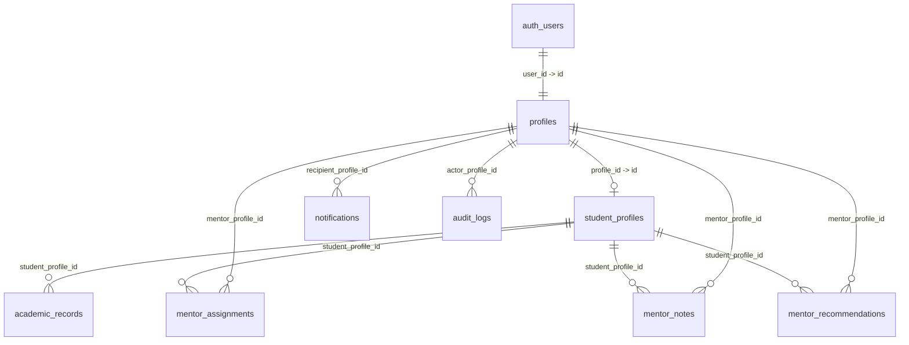

# Supabase Database Migrations & Row Level Security (RLS)

This directory contains the production-grade PostgreSQL migrations, non-recursive RLS policies, defense triggers, and automated test suite for the **Mentor–Mentee Management System**.

---

## Migration Inventory

| File | Description |
|---|---|
| [`migrations/20241029000001_initial_schema.sql`](./migrations/20241029000001_initial_schema.sql) | Core DDL: Enums (`app_role`, `verification_status`, etc.), 8 relational tables, primary keys, foreign keys, constraints, and indexes. |
| [`migrations/20241029000002_helper_functions_and_triggers.sql`](./migrations/20241029000002_helper_functions_and_triggers.sql) | `SECURITY DEFINER` non-recursive helper functions (`current_profile_id()`, `current_role()`, `is_assigned_mentor()`), tampering defense triggers, and `auth.users` sync. |
| [`migrations/20241029000003_row_level_security.sql`](./migrations/20241029000003_row_level_security.sql) | Explicit, granular Row Level Security (RLS) policies for `SELECT`, `INSERT`, `UPDATE`, and `DELETE` on all 8 tables. |
| [`migrations/20241029000004_rls_security_tests.sql`](./migrations/20241029000004_rls_security_tests.sql) | Automated SQL test harness testing 14 permitted and denied security scenarios across Mentees, Mentors, and Administrators. |
| [`apply_all_migrations.sql`](./apply_all_migrations.sql) | Unified single-file migration bundle for 1-click execution in the Supabase Web SQL Editor. |

---

## Table Structure & Foreign Key Map



---

## Permitted Access Matrix

| Entity | Mentee (Student) | Mentor (Faculty) | Administrator (HOD) |
|---|---|---|---|
| **profiles** | Read/Update own identity only. Role change blocked by trigger. | Read own + assigned students' profiles. | Full read/update for department profiles. |
| **student_profiles** | Read/Update own details (`draft`/`submitted`). Cannot self-approve or edit reviewer fields. | Read assigned students only. | Full read/update. Verifies, approves, or requests corrections. |
| **academic_records** | Insert/Read/Update own semester records. | Read assigned students' records only. | Full read/update for department students. |
| **mentor_assignments** | Read own assigned mentor. Cannot insert or edit. | Read own assigned students. | Full manage (Assign, reassign, deactivate). |
| **mentor_notes** | Read notes where `visibility = 'shared_with_mentee'`. | Author, update, delete own notes for assigned students. | Read department notes (except private notes). |
| **mentor_recommendations** | Read recommendations written for them. | Submit & update pending recommendations. Cannot self-approve. | Approve, reject, and record review comments & endorsements. |
| **notifications** | Read/Update (mark read)/Dismiss own notifications. | Read/Update/Dismiss own notifications. | Read/Update/Dismiss own notifications. |
| **audit_logs** | Read own action history only. | Read own action history only. | Full read for department actions. Immutable (no updates/deletes). |

---

## How to Apply Migrations

### Option A: Using Supabase Web Dashboard (Recommended)

1. Open your Supabase project: [https://supabase.com/dashboard](https://supabase.com/dashboard)
2. Navigate to **SQL Editor** from the left navigation.
3. Click **+ New Query**.
4. Open [`supabase/apply_all_migrations.sql`](./apply_all_migrations.sql), copy the entire file content, paste it into the SQL Editor, and click **Run**.
5. Once complete, run [`supabase/migrations/20241029000004_rls_security_tests.sql`](./migrations/20241029000004_rls_security_tests.sql) to execute the automated verification test harness. Look for:
   ```
   NOTICE: ALL 14 RLS & RBAC SECURITY TESTS PASSED WITH 100% SUCCESS!
   ```

### Option B: Using Supabase CLI

If you have the Supabase CLI configured locally:

```bash
# Link your project (if not linked)
supabase link --project-ref exbfbsqwrxuhctzldmte

# Push migrations
supabase db push
```

